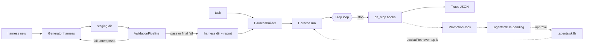
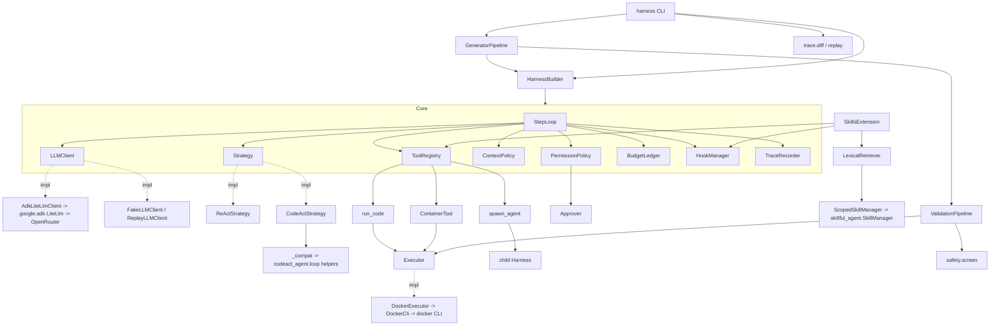
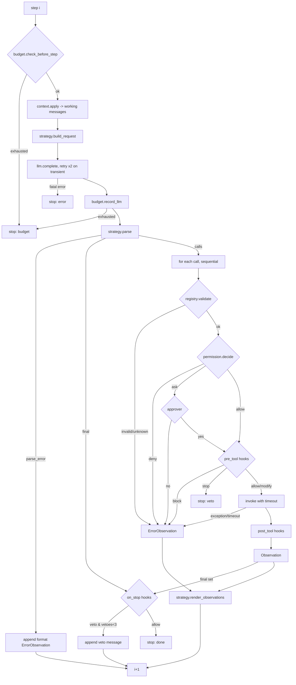

# Architecture & Flow Design: harness-builder

Input: `shared/prd.md` revision 3. Decision status is carried over from the PRD: D1, D2, D3, D5, D8 are CONFIRMED. D4, D6, D7, D9, D10, D11 and every numeric default are ASSUMED (pending user confirmation). New design choices introduced here are tagged `[DESIGN]`. The ones the user must confirm are collected in the section "Design decisions needing user input" (U1 to U12).

Sibling evidence (read-only, verified 2026-11-16 in a throwaway uv project in the scratchpad, not in the repo):
- `uv lock` resolves `google-adk>=1,<2` (1.39.1), `litellm>=1.50` (1.109.1), `skillful-agent` and `codeact-agent` as path sources together. `openai-agents` 0.24.0 and `openai` 3.51.0 are pulled in transitively by `codeact-agent`. There were no conflicts.
- `SkillManager._project_root`:
  - **editable** install: `D:\GitHub\agent-foundry\skillful_agent`, the sibling's own directory.
  - **non-editable** install: the *consuming* project's root. This is only because `.venv\Lib\site-packages\skillful_agent` is four levels below it.
- With an editable install, `discover_skills()` returned `['coding', 'preflight', 'task-reminder']` (the bundled skills of skillful_agent).
- Importing `skillful_agent.skill_manager` also imports `google.adk` through the package `__init__`. The cold first import took about 16 s.
- Importing `codeact_agent.loop` imports `agents` (openai-agents) through the package `__init__`. The cold first import took about 12 s. That import also does two other things:
  - monkey-patches `agents.models.chatcmpl_converter.Converter.items_to_messages` globally;
  - `codeact_agent.languages` builds a module-level `default_registry` (`awk`, `bash`, `python`, `text`) backed by the in-process `PythonSandbox`.
- `google.adk.models.lite_llm.LiteLlm.generate_content_async(llm_request: LlmRequest, stream: bool = False) -> AsyncGenerator[LlmResponse]` exists. `LlmResponse` has `content`, `finish_reason`, `error_code` and `usage_metadata`.

---

## Flow Design

### 1.1 Running a harness (library or `harness run`)

1. The caller builds a `Harness`, either from code with `HarnessBuilder` or from a spec with `HarnessBuilder.from_spec(dir_or_file)`. The builder is the only composition root: it resolves concrete layers and validates the config. If any registered tool needs the Executor, it runs Docker preflight, which fails fast with `DockerUnavailableError` (FR-044).
2. `await harness.run(task)` creates a `RunContext` containing:
   - `run_id`, `depth`, a budget ledger, the trace recorder and a working directory handle;
   - an initial message list: the system prompt from the Strategy plus extension contributions such as the skills catalog, then the user task.
3. The step loop (section 5) repeats until a stop reason is reached: `done`, `budget`, `veto` or `error`.
4. On stop, the `on_stop` hooks run (they can veto, within a bound), the trace is finalized and written, the executor workdir is cleaned up, and a `RunResult(answer, stop, usage, trace_path)` is returned.

### 1.2 Generator (`harness new`)

1. **Intake.** `GenerationRequest(description, examples, constraints, allowed_tools, interactive)`.
2. **Clarify** (interactive only). The generator harness may ask up to 5 questions through an `ask_user` tool.
3. **Draft.** The generator harness writes files into `<out>.staging/` using write tools. Their permissions only allow paths under the staging directory.
4. **Validate.** A deterministic `ValidationPipeline` (section 9.3) runs: static checks, then a fake-LLM smoke run, then the Docker tool-evals.
5. **Repair.** If validation fails, the `ValidationReport` is sent back to the generator harness as a new user turn. This happens at most 3 times (ASSUMED) and shares the generator's budget.
6. **Finalize.** The staging directory is moved atomically to `<out>/` and `reports/validation.{json,md}` is written. A failing result is still written, with `status: fail`; the README gets a banner and `harness run` refuses to run it without `--allow-failed`.

### 1.3 Skill promotion (M4)

1. At run end, the `PromotionHook` (`on_stop`, never vetoes) checks the verified-success signal: stop reason `done`, last `run_code` result has `final_set` and `exit_code == 0` (OQ-9).
2. `PromotionService` generalizes the snippet into a candidate: `SKILL.md`, `scripts/<name>.py` and `tests/test_<name>.py`. It calls `LLMClient` on its own promotion budget and writes the candidate to `.agents/skills-pending/<cid>/<name>/` with `candidate.json`.
3. `CandidateValidator` checks:
   - frontmatter;
   - that the script parses;
   - that the test passes in Docker;
   - that `ScopedSkillManager` loads the candidate with zero warnings;
   - dedup against the live library;
   - safety screening.
4. `harness skills review` shows the approval gate (D3). If approved, the candidate is promoted atomically into `.agents/skills/<name>/`.
5. On later runs, `LexicalRetriever` puts the top-k catalog entries into the prompt. The model then uses `activate_skill` and `run_skill_script` (the script runs in Docker).



---

## Component Diagram

### 2.1 Package layout (`src/harness_builder/`)

```
harness_builder/
  __init__.py            public API re-exports (Harness, HarnessBuilder, tool, ...)
  config.py              Settings (pydantic + python-dotenv): OPENROUTER_API_KEY, HARNESS_MODEL,
                         HARNESS_TRACE_DIR, HARNESS_SKILLS_ROOT, HARNESS_DOCKER_IMAGE
  errors.py              HarnessError, ConfigError, DockerUnavailableError, SpecError, ReplayDivergence
  core/
    types.py             Message, ToolCall, Observation/ErrorObservation, StepDecision, StopReason, Usage
    protocols.py         ALL layer Protocols (section 3); imports nothing concrete
    loop.py              StepLoop (section 5)
    run_context.py       RunContext, RunResult
    builder.py           HarnessBuilder, HarnessConfig, Harness (composition root)
  llm/
    types.py             LLMRequest, LLMResponse, ToolSchema (framework-neutral)
    adk_litellm.py       AdkLiteLlmClient (lazy-imports google.adk; D1)
    fake.py              FakeLLMClient (scripted / callable), used by tests and smoke runs
    pricing.py           PriceTable (package pricing.yaml + overrides + litellm.model_cost fallback)
    tokens.py            TokenCounter protocol impls: HeuristicCounter (chars/4), LiteLlmCounter
  strategies/
    registry.py          name -> factory ("react", "codeact"); register_strategy()
    react.py             ReActStrategy
    codeact/
      strategy.py        CodeActStrategy
      prompt.py          CODEACT_DOCKER_PROMPT (adapted from codeact_agent.prompts, section 7.3)
      _compat.py         the ONLY module that imports codeact_agent (lazy)
  tools/
    registry.py          Tool, ToolRegistry, @tool decorator, schema generation, arg validation
    builtin/run_code.py  RunCodeTool (Executor-backed, FR-045)
    builtin/deref.py     DerefTool (by-reference context)
    builtin/spawn.py     SpawnAgentTool (sub-agents, FR-011)
    container_tool.py    ContainerTool: generated tool executed in Docker (section 9.2)
  context/
    truncate.py  summarize.py  by_reference.py  store.py (ReferenceStore)
  permissions/
    policy.py            RulePermissionPolicy, NarrowedPolicy (child = strictest of parent/child)
    approvers.py         CliApprover (rich), AutoDenyApprover, StaticApprover (tests)
  budget/ledger.py       BudgetLedger (limits, child sub-ledgers)
  hooks/manager.py       HookManager (ordered, isolated)
  trace/
    models.py            Trace, TraceStep, TraceEvent union (schema_version=1)
    recorder.py          TraceRecorder (in-memory -> JSON file)
    redact.py            Redactor
    replay.py            ReplayLLMClient, ReplayToolRunner, replay()
    diff.py              diff_traces() -> TraceDiff
  executor/
    models.py            ExecRequest, ExecResult, SandboxConfig
    docker.py            DockerExecutor
    docker_cli.py        DockerCli protocol, SubprocessDockerCli (anyio.run_process), FakeDockerCli
    preflight.py         preflight(), doctor(), clean()
    paths.py             host path -> --mount src translation (Windows/POSIX)
    image/Dockerfile     pinned curated image
    image/hb_entry.py    in-container runner: FINAL channel, tool runner (copied into image)
  safety/screen.py       AST static screening (shared by generator and skills)
  spec/
    models.py            HarnessSpec v1 and sub-configs
    loader.py            spec -> HarnessBuilder; module tool loading
    io.py                YAML/JSON read/write, located errors
  evals/
    models.py            EvalCase (ToolCase | TaskCase), Check union, EvalReport
    runner.py            EvalRunner (FR-033)
  generator/
    request.py           GenerationRequest
    harness.py           builds the generator's own Harness (ReAct + write tools)
    pipeline.py          GeneratorPipeline (draft -> validate -> repair -> finalize)
    validate.py          ValidationPipeline, ValidationReport
    templates/           README / harness.yaml skeletons
  skills/
    _compat.py           the ONLY module that imports skillful_agent (lazy)
    store.py             ScopedSkillManager, SkillStore (live/pending/meta paths, stats sidecar)
    retriever.py         Retriever protocol, LexicalRetriever (BM25)
    extension.py         SkillsExtension.install(builder): prompt contributor, tools, hooks
    promotion.py         PromotionHook, PromotionService
    validation.py        CandidateValidator
    approval.py          ApprovalGate (interactive), atomic promote
    hygiene.py           list/show/stats/dedup/prune
  cli/
    main.py              click group `harness` (section 4.2)
```

Tests live in `harness-builder/tests/`: `unit/`, `conformance/`, `integration/`, `docker/`, `generator/fixtures/`, `skills/fixtures/`.

### 2.2 Dependency rules (NFR modularity)

- `core/types.py`, `core/protocols.py`, `llm/types.py`, `executor/models.py`, `trace/models.py` and `spec/models.py` are leaf modules. They import only stdlib and pydantic.
- Layer implementations depend on protocols and leaf models, never on another layer's concrete class.
- `core/builder.py` and `spec/loader.py` are the only composition roots that import concrete classes.
- Sibling imports are confined to `strategies/codeact/_compat.py` and `skills/_compat.py`. Both import lazily inside functions so that `import harness_builder` stays fast and ADK and openai-agents are never imported by tests that do not need them.
- `tests/unit/test_import_rules.py` enforces these rules with an AST walk over `src/`. No new dependency is needed for this.

### 2.3 Component diagram



External integrations:
- OpenRouter, via LiteLlm (network, LLM calls only);
- the Docker CLI and daemon (Docker Desktop on Windows, Docker Engine on POSIX);
- the local filesystem (`.harness/traces/`, `.agents/`, harness directories).

There is no database, no queue and no service.

---

## 3. Layer Interfaces (Protocols) and Default Implementations

All signatures are illustrative. Async methods run under anyio.

| Layer | Protocol (core/protocols.py) | Default impl | Test double |
|---|---|---|---|
| LLM | `LLMClient.complete(req: LLMRequest) -> LLMResponse` (async) | `AdkLiteLlmClient` | `FakeLLMClient`, `ReplayLLMClient` |
| Strategy | see 3.1 | `ReActStrategy`, `CodeActStrategy` | `EchoStrategy` (tests only) |
| Tools | `ToolRegistry`: `register(tool)`, `schemas(visible: set[str] or None) -> list[ToolSchema]`, `validate(call) -> ValidatedCall or ErrorObservation`, `async invoke(vcall, ctx) -> Observation` | `ToolRegistry` | registry with stub tools |
| Context | `ContextPolicy.apply(messages, ctx) -> list[Message]` (async; may call LLM) | `TruncatePolicy` | identity policy |
| Permissions | `PermissionPolicy.decide(call) -> PermissionDecision(allow, deny, ask; rule_id)`; `Approver.approve(req) -> bool` (async) | `RulePermissionPolicy` + `AutoDenyApprover` (non-interactive) / `CliApprover` (TTY) | `StaticApprover` |
| Budget | `Budget.check_before_step() -> StopInfo or None`, `record_llm(usage, model) -> StopInfo or None`, `child(fraction, limits) -> Budget`, `snapshot()` | `BudgetLedger` | same, with small limits |
| Hooks | `HookManager.pre_tool(call, ctx) -> HookOutcome`, `post_tool(call, obs, ctx) -> Observation`, `on_stop(result, ctx) -> HookOutcome` | `HookManager` | recording hooks |
| Executor | `Executor.run(req: ExecRequest) -> ExecResult` (async), `preflight() -> None` (raises), `languages: frozenset[str]` | `DockerExecutor` | `FakeExecutor` (scripted ExecResults) |
| Trace | `TraceSink.record(event)`, `finish(stop) -> Trace` | `TraceRecorder` | in-memory recorder |
| Retriever | `Retriever.index(entries)`, `search(query, k) -> list[ScoredSkill]` | `LexicalRetriever` (D4 ASSUMED) | fixed-result retriever |
| Token count | `TokenCounter.count(messages) -> int` | `HeuristicCounter` (deterministic) | same |

### 3.1 Strategy protocol

The loop owns the LLM call so that budget, trace and replay all live in one place. A Strategy only translates between messages and actions.

```python
class Strategy(Protocol):
    name: str
    required_tools: frozenset[str]  # CodeAct: {"run_code"}; ReAct: empty

    def system_prompt(self, base: str, tools: list[ToolSchema]) -> str: ...
    def build_request(
        self, messages: list[Message], tools: list[ToolSchema], model: ModelConfig
    ) -> LLMRequest: ...
    def parse(self, response: LLMResponse) -> StepDecision: ...
    def render_observations(self, results: list[ToolOutcome]) -> list[Message]: ...


class StepDecision(BaseModel):
    assistant: Message  # appended to history verbatim
    calls: list[ToolCall]  # executed sequentially by the loop
    final: str | None = None  # final answer when no further action
    parse_error: ErrorObservation | None = None  # malformed output -> fed back
```

### 3.2 Tool model (FR-005, FR-006)

```python
class Tool(BaseModel):  # frozen
    name: str
    description: str
    args_model: type[BaseModel]  # from explicit model or derived from typed signature
    fn: Callable[..., Any]  # sync -> anyio.to_thread; async awaited
    timeout_s: float | None = None
    nondeterministic: bool = (
        False  # marked in trace; replay always uses recorded output
    )
    risk: set[Literal["network", "filesystem_write", "code_exec", "subprocess"]] = set()


@tool(description="...")  # decorator builds Tool from a typed signature
def parse_csv(path: str, limit: int = 100) -> list[dict[str, str]]: ...


class ToolResult(BaseModel):  # optional richer return for tools
    content: str | dict[str, Any]
    final: str | None = None  # a tool may end the run (run_code FINAL, a "finish" tool)
```

Error observation, sent back to the model and never raised out of the loop:

```python
class ErrorObservation(BaseModel):
    type: Literal[
        "validation",
        "unknown_tool",
        "tool_exception",
        "permission_denied",
        "timeout",
        "hook_blocked",
        "format",
        "depth_exceeded",
        "executor_error",
    ]
    message: str
    hint: str | None = None
```

---

## Data Model Sketch

### 4.1 Core runtime models

- `Message(role: system|user|assistant|tool, content: str, tool_calls: list[ToolCall] = [], tool_call_id: str | None, ref: str | None)`
- `ToolCall(id, name, args: dict[str, Any])`. CodeAct code blocks become `ToolCall(name="run_code", args={"language", "code"})`.
- `Observation(call_id, ok: bool, content: str | dict, error: ErrorObservation | None, final: str | None, exec: ExecResult | None)`
- `StopReason = Literal["done", "budget", "veto", "error"]`; `StopInfo(reason, detail, step_index)`
- `Usage(input_tokens, output_tokens, cost_usd: float | None, llm_calls)`

### 4.2 Executor models (FR-045)

```python
class ExecRequest(BaseModel):
    language: Literal["python", "bash"]
    code: str
    timeout_s: float = 30  # ASSUMED (OQ-13)
    network: bool = False  # opt-in per run (FR-043)
    env: dict[str, str] = {}  # allowlist only; never inherits host env
    workdir: Path  # per-harness-run host temp dir (see U1)
    ro_mounts: dict[Path, str] = {}  # e.g. skill dir -> /skill, harness tools -> /tools
    stdin: str | None = None


class ExecResult(BaseModel):
    exit_code: int | None
    stdout: str
    stderr: str
    timed_out: bool
    truncated: bool  # either stream exceeded cap (64 KiB ASSUMED)
    oom_killed: bool
    duration_s: float
    final_set: bool  # FINAL() called
    final_value: str | None  # str(answer), read from /work/.hb/final.json
    container_name: str
    image: str
```

`SandboxConfig(image, timeout_s=30, output_cap_bytes=65536, memory_mb=512, cpus=1.0, pids=128, network=False, state_mode="stateless")`. All of these defaults are ASSUMED.

### 4.3 Trace (FR-012), schema_version 1

```
Trace
  schema_version: 1
  run_id, parent_run_id?, depth
  created_at                      (volatile)
  harness_name, config_hash       (sha256 of canonical resolved HarnessConfig JSON)
  spec_snapshot: HarnessSpec?     (present when built from spec; enables CLI replay)
  strategy, model, task
  steps: list[TraceStep]
  usage: Usage
  stop: StopInfo
  env: {harness_builder, python, os, adk, litellm versions}  (volatile)

TraceStep
  index
  events: list[TraceEvent]        (discriminated by "kind")
    llm_call      {purpose: step|summarize|promotion, request_fingerprint, request, response, usage, cost, latency_ms*}
    decision      {calls, final, parse_error}
    permission    {call_id, decision, rule_id, approver_result}
    hook          {event, hook, outcome: allow|modify|block|stop, error?}
    tool_call     {call_id, name, args, validation: ok|error}
    tool_result   {call_id, observation, duration_ms*, nondeterministic}
    context       {policy, tokens_before, tokens_after, refs_created}
    budget        {snapshot}
    subagent      {call_id, child: Trace}            (nested child trace, FR-011)
  (* = volatile; ignored by replay and diff)
```

Redaction (OQ-16, ASSUMED): `Redactor` runs at record time. It replaces the values of the configured secrets and of any env var whose name matches `*KEY*|*TOKEN*|*SECRET*|*PASSWORD*` with `[REDACTED:<NAME>]`. Replay compares redacted forms on both sides.

### 4.4 HarnessSpec v1 (FR-030, D9 ASSUMED)

```
HarnessSpec
  schema_version: Literal[1]
  name, description
  model: {name, temperature, max_output_tokens}
  strategy: {name: "react" | "codeact", options: {}}
  prompts: {system: str | {file: "prompts/system.md"}}
  tools: list[BuiltinToolRef{builtin, options} | ModuleToolRef{module: "tools/x.py", function, examples: [args...], runtime: docker|host}]
  context: {policy: truncate|summarize|by_reference, max_tokens, keep_last, ref_threshold_chars}
  permissions: {default: deny|ask|allow (deny ASSUMED), rules: [{tool: glob, args?: {name: glob}, decision}]}
  budget: {max_steps: 10, max_input_tokens?, max_output_tokens?, max_cost_usd?}
  hooks: list[BuiltinHookRef | ModuleHookRef{module, function, event, priority}]
  subagents: {max_depth: 2, profiles: {name: ChildProfile{strategy?, tools subset, budget_fraction, permissions narrowing}}}
  sandbox: SandboxConfig
  skills: SkillsConfig | null
  evals: {file: "evals/cases.yaml"} | inline list[EvalCase]
```

- Errors are located by pydantic `loc` and reported as `harness.yaml: tools[2].module: ...`.
- Module refs must resolve inside the harness directory. An absolute path or `..` is rejected.
- Strategies are referenced only by registered name. A spec cannot import arbitrary strategy code.

### 4.5 Generated harness directory (D10 ASSUMED)

```
<out>/                       default parent: ./harnesses/<name>/ (U7)
  harness.yaml
  prompts/system.md
  tools/__init__.py, tools/<module>.py
  tools.schema.json          tool JSON schemas extracted in Docker at validation time
  evals/cases.yaml
  README.md
  reports/validation.json, reports/validation.md
  .harness-meta.json         generator version, model, attempts, status: pass|fail
```

### 4.6 Evals (FR-033)

- `ToolCase(id, tool, args, check)`: deterministic. It runs the tool directly and needs no LLM.
- `TaskCase(id, input, check, runs: int = 1)`: needs an LLM.
- `Check`:
  - `Contains(text)`
  - `Regex(pattern)`
  - `Equals(value)`
  - `PyAssert(code)`, run in Docker with the answer available as `answer`
  - `Rubric(text, judge_model)`, run only on live runs
- `EvalReport(cases: [CaseResult(success_rate, mean_steps, tokens, cost, trace_paths)], totals)`

### 4.7 Skills storage (D6 ASSUMED)

```
<skills_root>/.agents/skills/<name>/SKILL.md, scripts/<name>.py, tests/test_<name>.py   (live; SkillManager-visible)
<skills_root>/.agents/skills-pending/<cid>/<name>/...  + <cid>/candidate.json           (never scanned)
<skills_root>/.agents/skills-meta/stats.json   usage_count, success_count, last_used per skill (FR-052 sidecar)
<skills_root>/.agents/skills-trash/<name>-<ts>/  replaced or pruned skills (recoverable)
```

Frontmatter:
- `name` must equal the directory name, in kebab-case;
- `description` is at most 200 characters (OQ-18);
- `triggers` is optional;
- no counters are stored in `SKILL.md`.

---

## 5. Control Flow of the Loop (FR-001)



Rules:
- **One step** is one LLM call plus the execution of all calls it returned. `max_steps` counts steps.
- **Validation re-check.** A `modify` outcome from a `pre_tool` hook is validated again against the args model. This keeps FR-005 true after modification.
- **Hook isolation `[DESIGN]`.** Every hook call is wrapped and traced. A failure in a `pre_tool` hook fails closed: it becomes `block` with `hook_blocked`. A failure in a `post_tool` or `on_stop` hook is ignored and traced (U9). Hooks run in ascending `priority`, then registration order.
- **Termination.** The loop has two backstops: the budget always bounds steps, and the `on_stop` veto count is capped (3). `error` is reserved for failures that cannot be turned into an observation, such as the LLM failing after retries, an internal invariant break, or `DockerUnavailableError` raised mid-run.
- **Sub-agents.** `spawn_agent(task, profile)` checks `ctx.depth + 1 <= max_depth` (default 2) and returns `depth_exceeded` otherwise. It builds the child through the same builder with:
  - a `NarrowedPolicy(parent, child)` (strictest wins: deny > ask > allow);
  - `parent_budget.child(fraction)`, a sub-ledger whose charges propagate to the parent.
  The child runs sequentially (OQ-24) and its trace is embedded as a `subagent` event.
- **Context policies (FR-007).** Each policy works on a working copy. The trace keeps the full canonical history.
  - `truncate`: keeps the system message, the task and the last N messages, within `max_tokens`.
  - `summarize`: older turns are folded into a running summary message by an `LLMClient` call (`purpose=summarize`), which is budgeted and traced.
  - `by_reference`: an observation longer than `ref_threshold_chars` is stored in `ReferenceStore` (in memory plus `<run_dir>/refs/`). It is replaced by `ref://<id>` and a preview, and `deref(ref, start, length)` is auto-registered.
- **Budget (FR-009).** Cost comes from `PriceTable`: the package `pricing.yaml`, then user overrides, then the `litellm.model_cost` fallback. If `max_cost_usd` is set and the model's price is unknown, the builder raises `ConfigError` at build time (fail closed, U10).

---

## 6. LLM Layer (FR-015, D1 CONFIRMED)

- **Do not reuse skillful_agent's `Agent` and `Runner`.** ADK's `Runner` runs its own tool loop and auto-executes tools, which would bypass permissions, hooks, budget and trace.
- **Use `LiteLlm` directly.** `AdkLiteLlmClient` keeps D1 (ADK + LiteLlm + OpenRouter) and calls `LiteLlm` at the model level, one call per loop step:
  1. Convert `LLMRequest` to `google.adk.models.llm_request.LlmRequest`:
     - `contents` become `types.Content` items; tool results become `function_response` parts;
     - `config = types.GenerateContentConfig(system_instruction=..., tools=[types.Tool(function_declarations=[...])], temperature=..., max_output_tokens=...)`.
  2. Run `async for r in LiteLlm(model="openrouter/<HARNESS_MODEL>", api_key=OPENROUTER_API_KEY).generate_content_async(req, stream=False)` and aggregate the result.
  3. Map `content.parts` to `text` and `tool_calls` (from `function_call`), and `usage_metadata.prompt_token_count` and `candidates_token_count` to `Usage`.
- **Construction and imports.** The skillful_agent pattern carries over: `LiteLlm(model=..., api_key=...)` from env through `python-dotenv`. harness-builder uses its own env var `HARNESS_MODEL`, not `SKILLFUL_MODEL`. The `google.adk` import is lazy, inside `adk_litellm.py` only (a cold import is about 16 s).
- **Errors.** A missing key or model raises `ConfigError("OPENROUTER_API_KEY not set; copy .env.example to .env")` when the client is built, before any call.
- **Pin.** `google-adk>=1.0.0,<2.0.0`, the same range as skillful_agent, so the shared editable environment co-resolves.
- **Fakes.** `FakeLLMClient(script: list[LLMResponse] | Callable[[LLMRequest], LLMResponse])` records requests. Its usage is computed by `HeuristicCounter`, which keeps it deterministic. All tests use it, and none touch the network.

---

## 7. Strategies and Conformance (FR-002..004)

### 7.1 ReActStrategy

- `build_request` sends the tool schemas as native function declarations.
- `parse`:
  - tool calls become `calls`;
  - text with no tool call becomes `final`;
  - malformed calls become `parse_error(format)`.
- `render_observations` produces `tool`-role messages, with an error rendered as `{"error": {type, message, hint}}`.

### 7.2 CodeActStrategy

- **Action space `[DESIGN]`, U11.** The model may emit fenced code blocks, native tool calls for the other registry tools, or both. This keeps the PRD acceptance "same task and tool set under both strategies" meaningful. It also replaces the sibling's in-sandbox `llm_query` with the `spawn_agent` tool, because a container with `--network none` and no API key cannot call an LLM.
- **`parse`.**
  - It extracts blocks with `codeact_agent.loop.extract_code_blocks`, which also normalizes language aliases.
  - Each `python` or `bash` block becomes `ToolCall("run_code", {language, code})`.
  - A block in an unsupported language becomes a `format` error that lists the supported languages.
  - Native tool calls are passed through.
  - A response with no blocks and no calls becomes `final` text. This is the sibling's "plain text answer" completion rule.
- **Same pipeline as tools.** Code goes through the full validate, permission, hook, invoke pipeline like any other tool call. There is no separate execution path.
- **Rendering.** `render_observations` formats `run_code` results in the sibling's `<execution><stdout/><stderr/><exception/></execution>` shape. It applies `codeact_agent.loop.truncate_output` (head+tail, 4,000 chars by default) as an **observation-level** cap. That cap is separate from the executor's byte-level 64 KiB cap (FR-042).
- **Stopping.** `FINAL()` works through `ExecResult.final_set`: the loop treats `Observation.final` as a completion request and runs it through `on_stop`. Remaining blocks in the same response are skipped, as in the sibling. Max steps are enforced by the budget.

### 7.3 Reuse of codeact_agent (D5, FR-061)

- **Imported**, lazily, through `strategies/codeact/_compat.py`:
  - `extract_code_blocks` and `truncate_output` from `codeact_agent.loop`;
  - `CODEACT_SYSTEM_PROMPT` from `codeact_agent.prompts`, read for the provenance check and the section-reuse test.
- **Adapted, not imported:**
  - **The loop.** `AgentLoop.run_turn` is bound to `CodeActAgent` (openai-agents `Runner`, `ResponseTextDeltaEvent` streaming). Its logic is re-expressed as the Strategy plus the framework loop, as follows.

    | Sibling loop element | Framework counterpart |
    |---|---|
    | the turn loop | `StepLoop` |
    | `max_turns` | budget `max_steps` |
    | code extraction | `parse` |
    | `registry.dispatch` | the `run_code` tool and the Executor |
    | the `FINAL` check | `Observation.final` |
    | the observation append | `render_observations` |
  - **The prompt.** `CODEACT_DOCKER_PROMPT` is derived from `CODEACT_SYSTEM_PROMPT`. It keeps:
    - the code-format section;
    - the FINAL contract;
    - the execution-feedback format;
    - the "use code for every task" and completion rules.

    It rewrites or drops the parts that are false under Docker:
    - the Python persistence guarantee (U1);
    - Git Bash and awk;
    - `register()`;
    - `llm_query` and `llm_query_many`, which are replaced by the `spawn_agent` tool;
    - the in-memory `ContextStore`, which is replaced by a file at `/work/context.txt`.

    A test asserts that the reused sections are textually present in the sibling prompt, to detect drift.
- **Not reused.** These conflict with D1 and D2:
  - `CodeActAgent` (openai-agents);
  - `PythonSandbox`, `FinalSignal` and `SandboxResult`, which are in-process;
  - `LanguageRegistry` and `LanguageExecutor`: their protocol returns `SandboxResult`, which would lose `timed_out`, `truncated` and `oom_killed`, and the package builds an in-process default registry at import;
  - `SubagentRunner`, which uses threads and openai-agents;
  - `bash_resolver`, since the host's Git Bash is irrelevant inside Linux containers.
- **Import cost and side effects.** Even importing the pure helpers executes `codeact_agent/__init__.py`. That:
  - imports openai-agents (about 12 s cold);
  - applies a global monkey-patch to `agents.models.chatcmpl_converter.Converter`;
  - builds the in-process `default_registry`.

  The patch and the registry are harmless to harness-builder, which never uses openai-agents or that registry, but they are real side effects. The lazy `_compat` import keeps them out of ReAct-only runs and out of most tests.
- **Mitigation options.**
  - **Option A (recommended now, zero sibling change):** accept the transitive dependency and import lazily.
  - **Option B (if OQ-8 allows):** a minimal sibling refactor that moves the pure helpers to `codeact_agent/parsing.py` (no openai import) and makes `codeact_agent/__init__.py` lazy (PEP 562 `__getattr__`). See U2.

### 7.4 Strategy conformance suite (tests/conformance/)

The suite is parametrized over `STRATEGY_FACTORIES = {"react", "codeact", "echo"}`. Each strategy has a test adapter, `encode(intent) -> LLMResponse`, which turns neutral intents into the strategy's native format:
- `CallTool(name, args)`: a ReAct function call, or for CodeAct a native call or a `run_code` block;
- `Finish(answer)`: ReAct text, or CodeAct `FINAL()` in a block with a `FakeExecutor` returning `final_set`;
- `Garbage()`: malformed output.

Shared cases:
1. Finish produces `done` and the answer.
2. A tool call then Finish runs the tool and the observation reaches the next request.
3. A validation error, an unknown tool, a tool exception and a timeout each become an `ErrorObservation` and the run continues.
4. `deny` becomes `permission_denied` and is traced; `ask` with `StaticApprover(False)` is denied.
5. `pre_tool` block means the model sees the reason; `pre_tool` stop gives `veto`.
6. `max_steps` gives `budget`.
7. `Garbage` produces a `format` observation.
8. The trace round-trips and replay matches.

The same task and tools run under each strategy by changing only `strategy.name`.

CodeAct-only cases:
- several blocks run in order and stop at `FINAL`;
- an unsupported language is reported;
- observation truncation;
- executor `timed_out` and `oom_killed` are rendered;
- `final_set` with exit 0 versus non-zero.

`EchoStrategy` exists only in tests and proves that a third strategy plugs in without changing the loop (FR-002).

---

## 8. Docker Executor (FR-040..046, D2 CONFIRMED)

### 8.1 Execution

`DockerExecutor.run(req)` works through the `DockerCli` protocol. `SubprocessDockerCli` uses `anyio.run_process` over the `docker` CLI. The CLI is used instead of the docker SDK: there is no extra dependency, it behaves the same on Docker Desktop and Docker Engine, and the socket is never touched from Python.

1. **Stage the code.** Write it to `<workdir>/.hb/code.<ext>`. Code is never passed as argv, which avoids Windows quoting and length limits.
2. **Create.** `docker create`, using the explicit lifecycle (U8) for reliable OOM detection:
   ```
   docker create --name hb-<run>-<n> --label harness-builder=1 --label hb.run=<run_id>
     --network none (unless req.network) --memory 512m --memory-swap 512m --cpus 1
     --pids-limit 128 --read-only --tmpfs /tmp:rw,size=64m --cap-drop ALL
     --security-opt no-new-privileges --user <uid>
     --mount type=bind,src=<host workdir>,dst=/work  [--mount ...,readonly for ro_mounts]
     -w /work [-e K=V for allowlisted env only] <image> python /opt/hb/hb_entry.py run <lang> /work/.hb/code.<ext>
   ```
3. **Start, with timeout and output cap.**
   - Run `docker start -a` under `anyio.fail_after(timeout_s)`.
   - Read stdout and stderr incrementally. Keep at most the cap per stream and drain the rest, so a 10 MB print cannot block the pipe or the host memory. Append the marker `\n[... truncated N bytes ...]`.
   - On timeout, `docker kill <name>`.
4. **Inspect.** `docker inspect` reads `State.ExitCode` and `State.OOMKilled`. A missing `final.json` means `final_set=False`.
5. **Clean up.** `docker rm -f <name>` always runs in `finally`. `harness doctor --clean` removes leftovers by label.

### 8.2 Isolation details

- **`FINAL` across the process boundary.** `hb_entry.py` injects `FINAL(answer)` into the exec namespace. It writes `str(answer)` as JSON to `/work/.hb/final.json` and raises a private `BaseException` that the entry script catches, then exits 0. For bash, the image puts a `hb-final "<answer>"` helper on `PATH`.
- **Environment.** The container gets an explicit allowlist (`PYTHONUNBUFFERED`, `HOME=/tmp`, plus `req.env`). It never receives `os.environ`, and it is never given `--env-file`. A test asserts that `OPENROUTER_API_KEY` is absent.
- **No Docker socket.** No mount of `/var/run/docker.sock` or `//./pipe/docker_engine` is ever generated. The mount builder rejects those paths.
- **Paths (D7 ASSUMED).**
  - Windows: `executor/paths.py` emits `--mount type=bind,src=C:\...` rather than `-v C:\...:/work`, which avoids drive-letter colon parsing.
  - POSIX: `--user $(id -u):$(id -g)` lets the container write to the host temp dir. On Windows, a fixed uid 10001 is used, since Docker Desktop bind mounts are permissive.
- **Image.** `executor/image/Dockerfile`: `python:3.11-slim` pinned by digest, a non-root user, and a curated package set (pydantic, pyyaml, plus whatever OQ-6 decides). It contains `/opt/hb/hb_entry.py` and `hb-final`. The tag is `harness-builder-sandbox:<content-hash>`, so a changed Dockerfile is detected.
- **Preflight and doctor (FR-044).** Each step has its own timeout, and the total time-to-fail is at most 5 s:
  1. `docker version` (is the CLI present);
  2. `docker info` (is the daemon up);
  3. `docker image inspect <tag>`; if this fails, the error prints the exact `docker build -t ... -f ...` command.

  Preflight runs in `HarnessBuilder.build()` when any tool needs the Executor. `harness doctor [--clean]` exposes the same checks and the label sweep.
- **State model (U1).** The recommended default is `state_mode="stateless"`:
  - each execution is a fresh container and a fresh process, so no Python variables persist between blocks;
  - the `/work` directory is per *harness run*, so files persist across blocks within one run;
  - nothing is shared across harness runs.

  The adapted prompt says so ("persist intermediate results to files in /work").

  An alternative, `state_mode="session"`, keeps one container per harness run with a long-lived Python kernel driven by `docker exec`. It is designed as an extension point but not built in v1 unless the user picks it. A timeout or OOM would kill the session and lose its state.
- **Isolation documentation (FR-046).** The docs and tests cover:
  - what is blocked: network, env, host filesystem outside the mounts, socket, privileges, resource caps;
  - what is not: a shared host kernel, kernel or container-escape CVEs, Docker Desktop VM-level limits, and the CPU/IO side channels.

---

## 9. Generator Pipeline and Validation (FR-030..035, D9..D11 ASSUMED)

### 9.1 Generator as a harness

`generator/harness.py` builds a `Harness` with the framework itself:
- **Strategy:** ReAct.
- **System prompt:** describes the HarnessSpec v1 schema and the tool-module conventions (pydantic args, type hints, `examples` per tool).
- **Tools:**
  - `write_file(path, content)`, confined to the staging dir by a permission rule plus a path guard;
  - `read_file`;
  - `list_builtin_tools`;
  - `get_spec_schema` (JSON schema of HarnessSpec);
  - `ask_user` (interactive only; otherwise auto-denied);
  - `submit()`, which ends the run.
- **Budget:** the generator's own budget, which covers all repair attempts.

The generator never executes the code it writes. Execution happens only in the pipeline's Docker stages.

### 9.2 Generated tools execute in Docker (U5)

Generated tool modules are generated code. D2 and Goal 4 require that generated code runs only in Docker, so:
- `ModuleToolRef.runtime` defaults to `docker`.
- At validation time, `hb_entry.py schema tools/x.py func` runs in a container with the harness dir mounted read-only. It imports the module and emits the JSON schema of the args model, which is saved to `tools.schema.json`.
- At runtime, the host registers a `ContainerTool` with that schema. Each call runs `hb_entry.py call tools/x.py func` with the args as JSON on stdin. The entry script validates the args with the real pydantic model *inside the container* before calling the body, so FR-005 holds: invalid args return a structured `validation` error and never reach the body. The result comes back as JSON on stdout.
- `runtime: host` is allowed only with an explicit `--trust-tools` flag or `HarnessBuilder(trust_host_tools=True)`. It is used for hand-written fixture harnesses in offline tests.

### 9.3 ValidationPipeline (FR-034)

Stage A (static, offline):
1. Parse `harness.yaml` as `HarnessSpec`, with located errors.
2. Check that every referenced module and function exists. AST parse; the function must have typed parameters or a pydantic args model, plus `examples`.
3. Run `ruff check` and `pyrefly check` on `tools/` as subprocesses from harness-builder's own environment. `ruff` and `pyrefly` are runtime dependencies, because the generator needs them at runtime.
4. `safety.screen` (AST) flags:
   - network imports and calls (`socket`, `urllib`, `requests`, `httpx`, `aiohttp`);
   - `subprocess`, `os.system` and `os.exec*`;
   - deletes (`os.remove`, `unlink`, `shutil.rmtree`, `rmdir`);
   - `eval`, `exec` and `__import__`;
   - secrets (key-like regexes and high-entropy literals).

   Every flagged tool gets an injected `ask` permission rule and appears in the report (FR-032).

Docker rule for validation: a harness with `runtime: docker` generated tools needs Docker for three things:
- `tools.schema.json` extraction (stage B0);
- the smoke run (stage B);
- the tool evals (stage C).

When Docker is unavailable, validation of such a harness ends with status `incomplete`, exits with code 3, and is **never** `pass`. No `FakeExecutor` substitution is allowed for generated tools in validation. Offline fixture tests use `--trust-tools` (host runtime, hand-checked fixtures), where stages B0, B and C run on the host for tools and use `FakeExecutor` only for `run_code`.

Stage B0 (schema, Docker): extract `tools.schema.json` as described in section 9.2. An import error or a missing args model fails this stage.

Stage B (smoke, fake LLM):
1. Build the harness from the directory. Preflight applies.
2. Script a `FakeLLMClient` to call each tool once with its first example, then finish.
3. The stage passes only if the run ends with `done`, there are no `validation`, `tool_exception` or `executor_error` observations, and the trace round-trips.

Stage C (Docker evals):
1. Run every `ToolCase` in Docker through `EvalRunner` with deterministic checks.
2. `TaskCase`s need an LLM and run only with `harness validate --live` (U6). Otherwise they are listed as "not run".

Repair: if stage A, B or C fails, the generator gets the failures and retries (3 attempts ASSUMED).

Result: `ValidationReport(status: pass|fail|incomplete, stages: [...], flagged_tools, attempts)`. A failed harness is never reported as passing: the CLI exits non-zero, `.harness-meta.json` says `fail`, and the README carries a FAILED banner.

### 9.4 Eval runner (FR-033)

`EvalRunner(harness_factory, cases, runs=N, llm=...)` runs on any harness, including hand-written ones:
- a `ToolCase` invokes the tool directly through the registry, so permissions and executor limits still apply;
- a `TaskCase` runs `harness.run(input)` N times and applies `check` to the answer.

It reports per-case success rate, mean steps, tokens, cost and trace paths. The skills eval (FR-057) calls the same runner twice, with an empty and a seeded `SkillsConfig`.

---

## 10. Skills Extension (FR-050..057; D3 CONFIRMED; D4, D6 ASSUMED)

### 10.1 SkillManager project root (PRD note 1)

What the code does: `SkillManager.__init__` sets `_package_dir = Path(__file__).parent`. Then `_find_project_root()` walks up from that directory, at most 10 levels, until it finds a `pyproject.toml`. `discover_skills()` scans three locations in increasing priority, and the bundled skills shadow everything:
1. `~/.agents/skills`
2. `<root>/.agents/skills`
3. `<package>/skills`

The constructor takes no arguments, and `_catalog` is cached after the first call.

Consequences when harness-builder runs, as measured:
- **Editable path install.** The root is `D:\GitHub\agent-foundry\skillful_agent`, so `harness-builder/.agents/skills` is **never** found.
- **Non-editable path install.** The root happens to be the consuming project. That works only because `.venv` sits inside `harness-builder/`, and it breaks if the venv lives elsewhere (`UV_PROJECT_ENVIRONMENT`). A non-editable install is also stale whenever the sibling changes, until it is reinstalled.
- **Either install.**
  - The bundled `coding`, `preflight` and `task-reminder` skills appear in the catalog, and they shadow same-named harness skills. The name collision logs a warning.
  - `~/.agents/skills` leaks in.
  - Both conflict with FR-050's "loads without warnings" requirement and with retrieval quality.
- **Caching.** After promotion, a new manager instance is needed because `_catalog` is cached.

Decision `[DESIGN]`:
1. Install both siblings **editable** (`editable = true`), so sibling changes are picked up without a reinstall.
2. **Never rely on `_find_project_root`.** Always pass explicit paths.
3. Implement explicit paths with option A (recommended, zero sibling change). `skills/store.py` defines `ScopedSkillManager(SkillManager)`:

   ```python
   class ScopedSkillManager(SkillManager):
       def __init__(self, search_paths: list[Path]) -> None:
           self._search_paths = [p.resolve() for p in search_paths]  # set BEFORE super()
           super().__init__()

       def _find_project_root(self) -> Path:  # neutralised
           return self._search_paths[0].parent.parent if self._search_paths else Path.cwd()

       def discover_skills(self) -> list[SkillCatalogEntry]:
           # same loop as the parent but over self._search_paths only, reusing inherited
           # _scan_dir(); no bundled package skills, no ~/.agents/skills by default
           ...
   ```

   It inherits `load_skill_body`, `list_skill_resources`, `_parse_skill_md` and `_scan_dir`. The cost is reliance on the private `_scan_dir`, `_parse_skill_md` and `_catalog`. A contract test (`tests/skills/test_skillmanager_contract.py`) pins those names and behaviours so that sibling drift fails loudly.
4. Option B (preferred if OQ-8 allows sibling edits): add a backwards-compatible `SkillManager(search_paths: list[Path] | None = None)` keyword argument to skillful_agent. `None` keeps today's behaviour. That makes the subclass a one-line construction. See U3.
5. **Skills root (U4).** Resolution order:
   1. `SkillsConfig.root` (spec or code);
   2. `--skills-root` (CLI);
   3. `HARNESS_SKILLS_ROOT` (env);
   4. otherwise, the nearest ancestor of the **current working directory** that contains `pyproject.toml`, falling back to CWD.

   This mirrors SkillManager's intent but anchors on CWD instead of on the installed package. Running from `harness-builder/` gives `harness-builder/.agents/skills`. Search paths are `[<root>/.agents/skills]`; `include_user_skills=False` and `include_bundled=False` by default.
6. **Pending candidates.** `.agents/skills-pending/` is never in `search_paths`, so unapproved skills are never discovered. To validate a candidate, a throwaway `ScopedSkillManager([<pending>/<cid>])` is built under `warnings.catch_warnings(record=True)` and must record zero warnings.
7. **Lazy import.** `skills/_compat.py` imports `skillful_agent.skill_manager` lazily. That import pulls in ADK through `skillful_agent/__init__.py` (about 16 s cold); ADK is already a dependency under D1, so only the import time matters.

### 10.2 Retrieval and use

- **`LexicalRetriever`.** Pure-Python BM25 over three fields: `name` (weight 2, tokens split on `-`), `description`, and `triggers`, read from the frontmatter through `_parse_skill_md`. The index is built once per run, and the target is under 100 ms for 1,000 skills.
- **Prompt contribution.** `SkillsExtension` retrieves the top-k entries (k = 3) on the task text at run start. Only name and description go into the prompt, in the agentskills.io `<available_skills>` XML shape. The full catalog is not built with `build_catalog_text`, because that would include every skill.
- **Tools.**
  - `activate_skill(name)` returns the body plus the resource list, and works only for retrieved names or explicitly requested ones.
  - `run_skill_script(name, script, args: dict)` mounts the skill dir read-only at `/skill`, passes the args as JSON on stdin, and runs through the Executor with the same limits (FR-052).
- **Usage stats.** A `post_tool` hook updates `skills-meta/stats.json` (usage and success counts) with an atomic write: temp file plus `os.replace`.

### 10.3 Promotion, validation and approval

- **`PromotionHook`.** An `on_stop` hook that never vetoes. Its errors are traced, never raised. Mode is `on_stop` (default) or `deferred`; deferred only writes `source.json` and leaves generalization to `harness skills propose`.
- **`CandidateValidator` (FR-054).** In order:
  1. Frontmatter: `name == dir`, kebab-case, description of at most 200 characters.
  2. `ast.parse` on the script.
  3. Test passes in Docker.
  4. `ScopedSkillManager` loads the candidate with zero warnings.
  5. Dedup: an exact name collision, or a BM25-normalized description similarity of at least 0.8 (ASSUMED, OQ-12), proposes merge, skip or replace.
  6. `safety.screen`.
- **`ApprovalGate` (FR-055).** It shows description, script, test output, dedup and safety report with rich, and asks for approval.
  - **Promote** copies the candidate to `.agents/skills/.tmp-<cid>/` and then calls `os.replace` to rename it to `<name>/`. Both are on the same filesystem, so the rename is atomic.
  - **Replace** first renames the old skill into `skills-trash/`.
  - **`--auto-approve`** is refused unless the root contains a `.hb-sandbox-library` marker; this is the eval library case (OQ-10).
- **Hygiene (FR-056).** `skills list|show|stats|dedup|prune`. They are dry-run by default, never auto-prune, and confirm before destructive actions; prune moves skills to trash.

---

## 10a. Path Dependency Mechanics (PRD note 2, D5 CONFIRMED)

The `harness-builder/pyproject.toml` sketch below is illustrative; the planner owns the exact pins. Dependencies are added with `uv add`, never pip.

```toml
[project]
name = "harness-builder"
requires-python = ">=3.11"
dependencies = [
  "google-adk>=1.0.0,<2.0.0", "litellm>=1.50", "pydantic>=2.0", "click>=8.0",
  "rich>=13.0", "python-dotenv>=1.0", "pyyaml>=6.0", "ruff>=0.15", "pyrefly>=1.0",
  "skillful-agent", "codeact-agent",
]
[project.scripts]
harness = "harness_builder.cli.main:main"

[tool.uv.sources]
skillful-agent = { path = "../skillful_agent", editable = true }
codeact-agent  = { path = "../codeact_agent",  editable = true }

[dependency-groups]
dev = ["pytest>=8", "anyio>=4", "pytest-timeout"]

[tool.pytest.ini_options]
markers = ["docker: needs a running Docker daemon", "live: needs a real LLM (HARNESS_LIVE=1)"]
```

| Item | skillful_agent | codeact_agent |
|---|---|---|
| Distribution name | `skillful-agent` | `codeact-agent` |
| Import name | `skillful_agent` | `codeact_agent` |
| Install | editable path source | editable path source |
| Imported by harness-builder | `skillful_agent.skill_manager.SkillManager`, `SkillCatalogEntry` | `codeact_agent.loop.extract_code_blocks`, `truncate_output`; `codeact_agent.prompts.CODEACT_SYSTEM_PROMPT` (provenance test) |
| Adapted (re-expressed) | ADK wiring pattern (`LiteLlm(model, api_key)` from env) moved into `AdkLiteLlmClient`, called without `Runner` | `AgentLoop.run_turn` logic moved into CodeActStrategy plus StepLoop; prompt moved into `CODEACT_DOCKER_PROMPT` |
| Not reused | `SkillfulAgent`, `Runner`/session wiring, `tools.py` (host bash/powershell), `BudgetTracker` (file-state token tracker; replaced by `BudgetLedger`) | `CodeActAgent`, `PythonSandbox`, `LanguageRegistry`, `SubagentRunner`, `bash_resolver`, `ContextStore`, `main.py` |
| Import side effects | `google.adk` loaded through the package `__init__` | `agents` (openai-agents) loaded, global Converter monkey-patch, in-process `default_registry` built |
| Transitive deps added | none beyond D1 | `openai-agents`, `openai` (unused at runtime) |
| Sibling changes required | none (option A); optional `search_paths` keyword argument (option B, U3) | none (option A); optional `parsing.py` and lazy `__init__` (option B, U2) |

Resolution was checked with `uv lock` (no conflicts; versions at the top of this document). Coupling risk: a breaking sibling change surfaces as a failure of the contract tests (`test_skillmanager_contract.py`, `test_codeact_compat.py`), not as a silent behaviour change.

---

## API Sketch

### 11.1 Python API

```python
h = (HarnessBuilder(name="csv-triage")
       .model("anthropic/claude-sonnet-4")         # HARNESS_MODEL default
       .strategy("codeact")                         # or "react"
       .tools(parse_csv, run_code())
       .context(TruncatePolicy(max_tokens=24_000, keep_last=12))
       .permissions(rules=[Rule("run_code", "allow"), Rule("*", "deny")])
       .budget(max_steps=10, max_cost_usd=0.50)
       .hook("pre_tool", my_hook, priority=10)
       .subagents(max_depth=2)
       .executor(DockerExecutor(SandboxConfig()))
       .build())                                    # preflight, ConfigError, DockerUnavailableError
result: RunResult = await h.run("Triage bugs.csv")
HarnessBuilder.from_spec("harnesses/csv-triage").build()
replay(trace: Trace, harness_factory) -> ReplayReport   # matched | divergence(step_index, expected, actual)
diff_traces(a: Trace, b: Trace) -> TraceDiff             # first_divergence + deltas
EvalRunner(factory, cases, runs=3).run() -> EvalReport
```

### 11.2 CLI (`harness`, OQ-28)

| Command | Purpose |
|---|---|
| `harness doctor [--clean]` | Docker preflight; sweep labeled containers |
| `harness run <dir or spec> "<task>" [--strategy S] [--trace PATH] [--allow-failed] [--trust-tools]` | run a harness |
| `harness new "<description>" -o <dir> [--non-interactive] [--max-attempts 3]` | generator |
| `harness validate <dir> [--live]` | validation pipeline |
| `harness eval <dir> [--runs N] [--live]` | eval runner |
| `harness replay <trace.json>` | offline replay (needs `spec_snapshot`) |
| `harness diff <a.json> <b.json> [--json]` | first divergence and deltas |
| `harness trace show <trace.json>` | rich rendering |
| `harness skills list, show, stats, review, propose, dedup, prune [--dry-run/--apply]` | skills |

Exit codes: 0 ok; 1 run failed or validation failed; 2 usage or config error; 3 Docker unavailable.

### 11.3 Replay and diff (FR-013, FR-014)

**Replay.**
- `ReplayLLMClient` returns the recorded `llm_call` responses in order. It compares each request fingerprint with the recorded one: a sha256 of the normalized request, with volatile fields removed.
- `ReplayToolRunner` takes the place of tool invocation (it is injected into the loop) and returns the recorded observations by `call_id` order. Tools and Docker are never executed, so replay works offline and without Docker.
- A divergence is reported as `ReplayDivergence(step_index, kind: request|decision|tool_call|stop, expected, actual)` when any of these happens:
  - a fingerprint mismatch;
  - an extra or missing LLM call;
  - a different tool call (name or normalized args).

**Diff.**
- Steps are aligned by index. The first divergence is the first step whose decision differs: tool names, normalized args, final text or the hash of the response text.
- Deltas cover steps, input and output tokens, cost, tool usage counts and stop reason.
- Rendering is rich, or JSON with `--json`.

---

## 12. Test Strategy

- **Offline by default.**
  - `uv run pytest` needs no network and no Docker.
  - Every LLM call goes through `FakeLLMClient`.
  - Executor unit tests use `FakeDockerCli`, which asserts the exact argv: flags, mounts, the absence of an env leak, labels, and the kill-on-timeout sequence. `FakeDockerCli` also simulates output floods and the OOM inspect result.
- **`docker` marker.** `tests/docker/conftest.py` runs `docker info` with a 5 s timeout and skips with the reason `"Docker not available: <error>"`. The Docker tests cover:
  - timeout kill within timeout+5 s and no leftover container;
  - a 10 MB print capped at the limit plus the marker;
  - no state leak across harness runs;
  - no `OPENROUTER_API_KEY` in the container;
  - `socket.create_connection` failing under `--network none`;
  - a memory hog reported as `oom_killed`;
  - a write attempt on the read-only rootfs;
  - the documented escape attempts (FR-046);
  - generated-tool schema extraction and calls;
  - skill script runs.
- **`live` marker.** Opt-in with `HARNESS_LIVE=1` and a key. Covers `AdkLiteLlmClient` against OpenRouter and live `TaskCase` evals.
- **Conformance.** As in section 7.4.
- **Integration.**
  - Code-built and spec-built harnesses produce equal traces, excluding volatile fields; this also checks `config_hash` equality (FR-016).
  - Record and then replay matches exactly; a perturbed fake gives the divergence index.
  - `harness diff` CLI output through click's `CliRunner`.
  - Sub-agent nesting, depth limit and budget propagation.
  - Each context policy stays under its limit; by-reference round-trips content.
- **Generator.**
  - Three fixture domains: CSV bug triage, repo Q&A over a fixture folder, and unit conversion. Each has a scripted `FakeLLMClient` that drives the generator harness to write known files.
  - Each fixture asserts that the output loads, passes stages A and B offline (fixture tools with `--trust-tools`), and passes stage C under the `docker` marker.
  - A deliberately broken tool (a bad signature, or a body that raises) must be caught by stage A or B, giving status `fail` and exit code 1.
- **Skills.**
  - Fixture library of about 30 skills with labelled queries for the top-3 hit rate, target at least 90% (ASSUMED).
  - Generated library of 1,000 skills for the under-100 ms check.
  - Contract tests on the private SkillManager API.
  - Atomic promotion, including a simulated crash between copy and rename.
  - Auto-approve refused without the sandbox marker.
- **Guards.**
  - Import-rule test (section 2.2).
  - Per-step framework overhead under 50 ms with the fake LLM and a no-op tool, measured as a median over 100 steps with a generous CI margin.
  - `test_codeact_compat.py` pins the sibling helpers' behaviour and prompt sections.
- **Tooling.** anyio with `anyio_backend = "asyncio"`; ruff (88 columns) and pyrefly clean.

---

## 13. Milestone Mapping

**M1: Framework core (FR-001..016).** Freeze `core/protocols.py`, `executor/models.py` (`ExecRequest`, `ExecResult`, `Executor` protocol) and `trace/models.py` early, so that M2 can overlap.
- Modules:
  - `core/*`, `llm/*` (`adk_litellm`, `fake`, `pricing`, `tokens`), `strategies/registry.py` and `react.py`;
  - `tools/registry.py`, `builtin/deref.py`, `builtin/spawn.py`;
  - `context/*`, `permissions/*`, `budget/*`, `hooks/*`, `trace/*`;
  - `config.py`, `errors.py`;
  - CLI `run` (code or spec-lite), `diff`, `replay` and `trace show`.
- A minimal `spec/models.py` and `loader.py` are needed for FR-016. Its fields cover only the M1 layers; it is extended in M3, and the version stays 1 until release.
- Exit: AC 2, 3 and 4 with ReAct plus `EchoStrategy`.

**M2: Docker executor and CodeAct (FR-040..046, FR-004).**
- Modules: `executor/*` (Dockerfile, `hb_entry.py`, preflight, doctor), `tools/builtin/run_code.py`, `strategies/codeact/*` including `_compat.py`.
- Contract test on codeact_agent; Windows mount verification; latency measurement against the 3 s target (OQ-13).
- Exit: AC 1, AC 2 with both strategies, and AC 5.

**M3: Generator (FR-030..035).**
- `evals/*` (the runner comes first and is usable by M4);
- full `spec/*`, `safety/screen.py`, `tools/container_tool.py` and the `hb_entry` schema/call modes, `generator/*`;
- CLI `new`, `validate` and `eval`.
- Exit: AC 6.

**M4: Skills (FR-050..057).**
- `skills/*`: `_compat`, `ScopedSkillManager` and its contract test, `retriever`, `extension`, `promotion`, `validation`, `approval`, `hygiene`;
- CLI `skills ...`;
- skills eval.
- Exit: AC 7 and 8.

**M5: Docs and hardening (FR-060).**
- README, layer reference, writing a tool, strategy or hook, generator workflow, replay and diff, skill format and approval, the isolation-limits document, `.env.example`, the final eval report;
- option B sibling refactors, if the user approves U2 and U3.

Cut order if scope shrinks (OQ-27 ASSUMED): M5, then M4, then M3 stage C and repair.

---

## Non-Functional Considerations

- **Performance.**
  - Lazy imports of ADK, openai-agents and skillful_agent keep `harness --help` and ReAct-with-fake runs fast. The measured cold import costs are 12 s and 16 s.
  - Container overhead with the create/start/inspect/rm lifecycle is 4 CLI calls per execution. It is measured in M2 against the 3 s target (ASSUMED). If it misses on Windows, the fallbacks are `docker run --rm` with exit-137 OOM inference, or session mode (U1/U8).
  - BM25 is in-memory. Framework step overhead is under 50 ms.
- **Security.**
  - Generated code runs only in Docker, and that includes generated tools (U5).
  - The container never gets host env; network is off; caps are dropped; no-new-privileges; non-root; read-only rootfs; the socket is never mounted.
  - Permissions deny unlisted tools (ASSUMED, OQ-22). Statically risky tools are forced to `ask`.
  - `pre_tool` hook failure fails closed. Secrets are redacted in traces.
  - The generator's write tools are path-guarded to the staging dir.
  - Spec module refs are confined to the harness dir. Strategies are referenced by name only.
- **Reliability.**
  - Every run terminates: budget, capped `on_stop` vetoes, per-tool timeouts, executor timeouts, and a bounded repair loop.
  - Containers are removed in `finally` and swept by label. Temp dirs are removed at run end.
  - Promotion and stats writes are atomic (`os.replace`).
- **Scaling.** Single process and single user. Sub-agents run sequentially (OQ-24) and tool calls within a step run sequentially. Neither parallel children nor a warm container pool is part of v1; both remain possible later without changing the interfaces, since `Executor` and `spawn_agent` already hide the scheduling.
- **Portability (D7 ASSUMED).** Windows-safe bind mounts through `--mount`, and anyio subprocesses instead of `resource` or fork. Container paths are POSIX; host paths are handled by `pathlib`.
- **Stability.** `HarnessSpec` and `Trace` both carry `schema_version: 1`. A loader for an unknown version raises `SpecError` with the expected versions.

---

## Design decisions needing user input

Each item has a recommended default, which the plan will use unless the user overrides it.

- **U1. CodeAct state model.** D2 and FR-040 require a fresh container per execution, but the sibling CodeAct prompt promises Python state that persists across blocks.
  - *Recommended:* `stateless`. Each block gets a fresh container; `/work` files persist within one harness run; nothing persists across runs; the prompt is rewritten to say so.
  - *Alternative:* `session`. One container and a persistent kernel per harness run, through `docker exec`. This is closer to the sibling but more complex, and a timeout loses state.
  - Also confirm that the FR-040 "run A versus run B" no-leak acceptance applies at harness-run level.
- **U2. Reuse mechanics for codeact_agent.**
  - *Recommended now:* option A. Import `extract_code_blocks` and `truncate_output` lazily, adapt the prompt and loop, and accept openai-agents as an unused transitive dependency, along with its import-time global monkey-patch and in-process `default_registry`.
  - *Option B (needs OQ-8 approval):* a minimal sibling refactor, a side-effect-free `codeact_agent/parsing.py` plus a lazy `__init__`.
  - Please also acknowledge that `LanguageRegistry`, `PythonSandbox` and the verbatim prompt are **not** reused. This narrows FR-061's "loop/prompts/languages".
- **U3. SkillManager integration.**
  - *Recommended now:* editable install plus option A, a `ScopedSkillManager` subclass with explicit search paths. It relies on the private `_scan_dir` and `_parse_skill_md`, pinned by a contract test.
  - *Option B (needs OQ-8 approval):* add a backwards-compatible `search_paths` keyword argument to `SkillManager`.
- **U4. Skills root and catalog scope.** Default root: nearest `pyproject.toml` ancestor of CWD, overridable by spec, CLI or env. Exclude skillful_agent's bundled skills and `~/.agents/skills` from harness catalogs by default. Confirm, or say whether user-level skills should be included.
- **U5. Generated tools run in Docker by default.** This follows from D2. It means any harness with generated tools needs Docker at runtime, and the smoke run's tool bodies need Docker. Host execution would be allowed only with `--trust-tools`. Confirm.
- **U6. Validation stage C (OQ-21).**
  - *Recommended:* deterministic `ToolCase` evals in Docker by default; `TaskCase` (LLM) evals only with `--live`; no human gate.
  - *Alternatives:* make a live run mandatory, or use an independent judge model.
- **U7. Generated harness location (OQ-20).** Default `./harnesses/<name>/` relative to CWD, with `-o` overriding it. Should generated harnesses be committed to git?
- **U8. Container lifecycle.** Use `docker create`, `start -a`, `inspect` and `rm -f` (reliable `OOMKilled`) instead of the PRD's literal `docker run --rm`. The cost is about 3 extra CLI calls per execution. If M2 latency misses the target, fall back to `--rm` with exit-137 inference.
- **U9. Hook failure policy.** A `pre_tool` hook exception blocks the action (fail-closed). `post_tool` and `on_stop` exceptions are ignored and traced. Confirm.
- **U10. Unknown model price with a cost cap.** Refuse to build (`ConfigError`) when `max_cost_usd` is set and neither `pricing.yaml` nor `litellm.model_cost` knows the model. The alternative is to warn and not enforce cost.
- **U11. CodeAct action space.** Code blocks plus native tool calls, so that registry tools and `spawn_agent` work under CodeAct and "same tool set under both strategies" holds. The sibling's `llm_query` is dropped in favour of `spawn_agent`. Confirm.
- **U12. Trace storage.** `./.harness/traces/<run_id>.json` (gitignored), no automatic retention, and the redaction rules in section 4.3 (OQ-16 and OQ-26).

## Open Architecture Decisions and Risks

- **Decision: CodeAct state model.**
  - Options: stateless per block (files persist per run) / session container.
  - Recommended: stateless (U1).
- **Decision: sibling reuse mechanics.**
  - Options: lazy import with transitive dependencies / minimal sibling refactor / vendoring (rejected by D5).
  - Recommended: lazy import now, refactor if OQ-8 allows (U2, U3).
- **Decision: LLM integration level.**
  - Options: ADK `Runner` and `Agent` / `LiteLlm.generate_content_async` directly / raw litellm.
  - Recommended: direct `LiteLlm`. It keeps D1 and lets the framework own the loop.
- **Decision: where generated tools execute.**
  - Options: Docker through `ContainerTool` / host.
  - Recommended: Docker (U5).
- **Decision: Docker client.**
  - Options: docker CLI subprocess / docker-py SDK.
  - Recommended: CLI. No dependency, the same on Desktop and Engine, and it can be faked in tests.
- **Decision: where the CodeAct observation cap lives.**
  - Options: the executor cap only / both caps.
  - Recommended: both. The executor uses a byte cap (64 KiB) for safety; the strategy uses `truncate_output` (4,000 chars) for context hygiene.
- **Risk: sibling private API drift** (`_scan_dir`, `_parse_skill_md`, the loop helpers). Mitigation: contract tests; option B refactors.
- **Risk: import-time side effects of codeact_agent** (global openai-agents patch). Mitigation: lazy `_compat` import, never imported in ReAct-only paths; option B.
- **Risk: Windows Docker Desktop latency and mount quirks.** Mitigation: `--mount` syntax, M2 measurement, U8 fallback.
- **Risk: fake-LLM smoke validation gives limited assurance about generator quality.** Mitigation: Docker `ToolCase` evals, an explicit "not run" listing for `TaskCase`, and the `--live` option.
- **Risk: the stateless CodeAct model lowers the success rate on multi-step data tasks.** Mitigation: `/work` file persistence within a run, prompt guidance, and session mode as an extension point.
- **Risk: ruff and pyrefly as runtime dependencies make the install heavier.** Accepted, because the generator needs them at runtime.

DESIGN_COMPLETE
